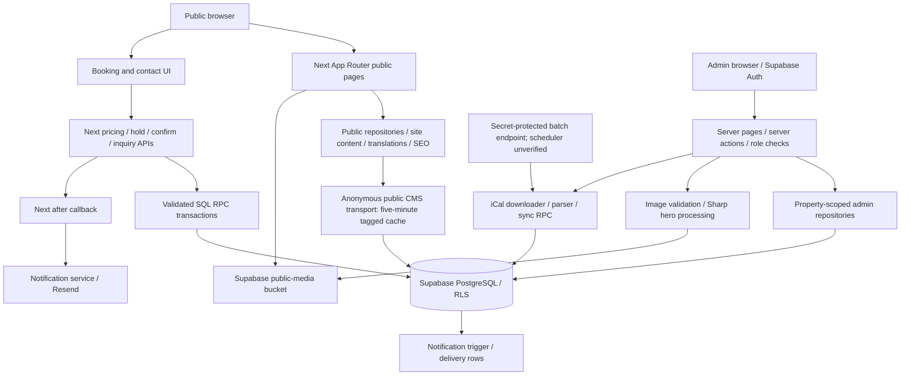

# Borealis full platform audit

2026-10-20 (Europe/Tirane). Canonical repository: `/Users/aleksandermarleci/Desktop/Projects/borealis-guesthouse`. Audit only; no fixes or deployment.

**Overall: PARTIAL platform verification; production-release readiness FAIL.** The informational website builds and serves its seven approved preview pages. The entire platform cannot be certified as working. One P0 draft confidentiality issue, several confirmed admin/public disconnects and untested transactional workflows prevent that conclusion. No source, production data, settings, migrations, deployment or running-preview lifecycle was changed by this audit.

## Evidence and interpretation

PASS means the specific stated check passed. FAIL identifies a demonstrated code/configuration defect, not automatically an exploited incident. PARTIAL means implementation is present but incomplete or only partly verified. NOT TESTED means the required safe runtime/role/provider evidence is absent. “Fully connected” in the connection matrix describes a traced read/write contract, not proof of a successful production save.

Evidence reviewed: current canonical source and lockfile; architecture/development decisions; local preview plan/build/launcher/cache/image/acceptance reports; historical booking/admin/mobile audits; notification/iCal docs; all migration filenames and application function call sites; existing production catalog snapshots from earlier on 2026-10-20. No guest rows, real booking tokens, draft values, browser stores or privileged credential values were queried. Existing catalog evidence was sufficient for the permission findings; no new production SQL was issued.

The earlier catalog contains 60 public tables with RLS enabled (none FORCE RLS), 907 columns, 372 constraints, 115 policies including Storage, 1,240 table grants, 65 triggers and 44 application function records (232 including extensions). Recorded function-body reconciliation matched each of the 44 against at least one repository definition. That is not proof of migration order, complete schema parity, ownership, index coverage or live role behavior. No standard Supabase migration ledger was found; 41 migration files remain historically unreconciled as applied/not applied. Do not replay them.

## Current validation results

| Check | Result and exact scope |
| --- | --- |
| Unit suite | PASS: 125/125 under pinned Node 20.19.5, reviewed TypeScript loader and OS deny-network policy |
| ESLint | PASS: complete current configuration, exit 0 |
| TypeScript | PASS: noEmit, incremental disabled, exit 0 |
| Dependency consistency | PASS: npm ls --all --offline, no dependency problems; no installation |
| Preview source/artifact/dependency hashes | PASS: 318 source files, all 500 recorded artifacts, 22,428 dependency entries unchanged; current canonical source matches the v7 snapshot except expected compiler config files |
| Existing launcher cache/ownership regressions | PASS: 22/22 existing mocked cache/ownership cases; no application process created/signaled |
| New isolated full build | PASS: Next 16.3.4 Webpack, Node 20.19.5,47.8s, paired flags 1/1, sterile env, OS deny network* |
| Local approved-page HTTP | PASS: all seven 200, title/main HTML, CSP/no-store/noindex, no Set-Cookie/redirect |
| Public production SEO read | FAIL: robots/sitemap both 200 but page discovery origin is http://localhost:3000 |
| Authenticated admin create/save/publish | NOT TESTED: prohibited on production; static/backend tracing completed |
| Booking/payment/contact/calendar mutations | NOT TESTED: none invoked; only synthetic/mock validation |
| New desktop/mobile browser acceptance | NOT TESTED: isolated automation unavailable; no normal authenticated profile substituted |
| Current external advisory vulnerability scan | NOT TESTED: offline dependency consistency is not a vulnerability scan |

The audit build is a new private temporary copy in `/private/tmp/borealis-platform-audit/build-source`, with cloned verified dependencies and no copied dotenv or previous build output. It generated 498 files; it is not expected to be byte-identical to a different build at a different path. The existing runtime's sealed 500-file build identity remains unchanged. No new launcher was sealed and no audit build was started. Public key was privately fingerprint-checked and supplied as public preview configuration; no privileged integrations were supplied and no build network was possible. Raw build logs and compiled public configuration remain private temporary evidence.

Fresh audit HTTP checks used the already-running image-enabled v7 preview, not the older v4/v5 reports. PID 18704 still listens only on IPv 4 127.0.0.1:3000. It was left running per the owner's earlier instruction. Requests carried no cookies/authorization, used no inherited proxy and disabled redirect following. HTML response checks are not browser rendering, CMS provenance or a complete upstream traffic trace. Local font byte checks are recorded in the UI report.

## Architecture map

The read-only preview adds server/browser instrumentation, strict route/method/query/origin and fixed Supabase projection validation, disabled authenticated/browser/service clients, session-header stripping and restrictive CSP. v7 additionally permits nine exact anonymous public image destinations; it does not enable booking/admin/Auth/storage writes or the general optimizer. These application controls are not a production read-only database role or a host-wide firewall.

## Component classification

| Component | Classification | Evidence/limits |
| --- | --- | --- |
| Seven public informational routes | Implemented and verified for bounded HTTP only | Fresh audit 200/security headers; current full visual and field completeness unverified |
| Local fonts / static assets | Implemented and verified for loading | Sealed local files, successful no-network build and font response checks |
| Detail pages / booking / confirmation / contact | Implemented but unverified end to end | Source/SQL traced; excluded from restricted runtime testing |
| Public CMS and cache invalidation | Partially implemented/verified | Reader mappings and tags exist; F01,F04–F07,F18 affect trust/completeness |
| Admin modules | Implemented but unverified as workflows | Real repositories/actions, per-module roles; no production saves |
| Gallery image membership | Broken connection | Media Library does not maintain gallery_items (F06) |
| Multilingual content | Partially connected | Several field contracts differ (F05) |
| Room pricing / occupancy / reservations | Implemented with strong SQL controls, runtime concurrency unverified | Authoritative RPC, row/advisory locks and exclusion constraint; F12–F14,F27 |
| Experience bookings | Partially implemented/verified | Shared capacity SQL and standalone flow; incomplete operational override tooling |
| Transfers | Implemented with limited inventory model | Add-ons and request capacity; no aggregate fleet/seat ledger |
| Contact inquiries | Implemented but unverified | Honeypot/validation and SQL queue, admin status action; no real submission |
| In-app notifications / realtime | Implemented but unverified live | Trigger, list/read actions and browser subscription; publication delivery not inspected |
| Owner emails | Implemented but inactive locally / operationally unverified | Blank local provider/service credentials; F09 |
| Guest confirmation email | Missing delivery backend | Stored switch does not have a sender (F08) |
| Calendar import/export | Partially implemented, unverified | Owner/secret gates and token export; scheduler not established |
| Online payments | Implemented settings only; inactive | No checkout/webhook/refund provider workflow found |
| Maps | Implemented but not runtime accepted | Approved Google URL resolver/embed; blocked in preview |
| Analytics | Not configured in inspected application | No analytics SDK/tag consumer found; host-side analytics not inspected |
| Legacy pages/content actions | Duplicated/obsolete candidate | Active homepage has a different source; F25 |
| Compatibility route aliases | Intentionally duplicated redirects | room-types/rate-rules/pages legacy entry routes redirect |
| User/role provisioning UI | No general manager found | Active admin_profiles role checks exist; owner/staff account creation not tested or authorized |
| Deployment/recovery | Partially configured, not release-ready | Main auto-publish historical evidence; dirty/private working tree, SEO and recovery gates |

## Findings register

The detailed evidence, root cause/hypothesis, impact, correction, dependencies, database-change decision, tests and acceptance for **every issue** are in [the remediation roadmap](BOREALIS-REMEDIATION-ROADMAP.md). No fixes were implemented.

| ID | Priority | Status | Finding |
| --- | --- | --- | --- |
| F01 | P0 | FAIL | Published CMS rows expose the draft column |
| F02 | P1 | FAIL | Anonymous callers can execute an internal reference-counter writer |
| F03 | P1 | FAIL | Storage and media retain a second legacy authorization model |
| F04 | P1 | FAIL | Multi-step admin saves can leave partial public changes |
| F05 | P1 | FAIL | Several translation controls do not feed the displayed fields |
| F06 | P1 | FAIL | Gallery image management is not connected to gallery membership |
| F07 | P1 | FAIL | Archive protection misses published media references |
| F08 | P1 | FAIL | Guest confirmation email setting has no sender |
| F09 | P1 | PARTIAL | Owner email delivery lacks durable claiming and retry recovery |
| F10 | P1 | PARTIAL | Automatic calendar synchronization is not established |
| F11 | P1 | PARTIAL | Calendar URL protection does not pin the validated DNS destination |
| F12 | P1 | PARTIAL | Booking retry behavior is not idempotent |
| F13 | P1 | PARTIAL | Public holds and pricing lack an evidenced abuse budget |
| F14 | P1 | NOT TESTED | A complete safe functional and recovery certification is missing |
| F15 | P1 | FAIL | Private runtime/browser material is not excluded from Git |
| F16 | P1 | FAIL | Production SEO advertises localhost |
| F17 | P2 | FAIL | SEO URL editing is disconnected from static routes |
| F18 | P2 | PARTIAL | Fallbacks and property selection hide data-source failures |
| F19 | P2 | PARTIAL | Some policy settings are stored without full behavioral enforcement |
| F20 | P2 | PARTIAL | Operational inventory controls have limits that the owner must understand |
| F21 | P2 | FAIL | Gallery dialogs do not provide a complete keyboard focus lifecycle |
| F22 | P2 | FAIL | Admin preview destination validation accepts protocol-relative redirects |
| F23 | P2 | PARTIAL | Runtime/dependency support and test command need alignment |
| F24 | P2 | PARTIAL | Admin list and quote cost need scale tests |
| F25 | P2 | PARTIAL | Legacy content paths increase source-of-truth ambiguity |
| F26 | P2 | PARTIAL | Owned shutdown is safe but its result reporting still has an exit race |
| F27 | P1 | FAIL | Albanian Lek is offered by admin but rejected by room/package SQL |

## Repository and deployment identity

Canonical main HEAD is `745b4aa56589cda5e5d0c8823ccc1cabb055e313`. A read-only GitHub main comparison earlier in this audit matched it. A later unprivileged repeat failed DNS resolution; no refs were fetched or changed. Therefore the earlier match is time-bounded, not a promise the remote cannot move. Ten pre-existing tracked modifications remain (29 insertions/7 deletions); preview modules, local fonts and many reports are untracked. `.local/` itself appears untracked, a release hygiene defect (F15). No commit, staging, push or merge occurred.

The available read-only Netlify Dashboard record from earlier on the same day identifies site `borealisguesthouse`, ID `4086f82d-2d8f-46af-9deb-679015b2cec1`, production branch main, published revision 745b 4aa, auto-publishing enabled and deploy previews sharing production Supabase variables. This audit did not obtain a new authenticated control-plane snapshot: no Netlify CLI/connector was available and no new browser/account setup was attempted. Treat current deploy toggles, team plan and full environment inventory as NOT freshly verified. The fresh public robots/sitemap read does verify the live localhost-origin defect independently.

`netlify.toml` uses npm run build, publish .next and Node 20.19.5; static Next assets get immutable cache headers. The earlier Dashboard functions path had no corresponding scheduled source in the inspected repository. Only the two public Supabase variables were listed in the earlier project-level Dashboard inventory; team/context secrets were not exhaustively verified. Canonical SITE_URL/APP_URL, provider secrets and preview segregation need a new authorized release check. Do not add local read-only flags to Netlify. A main push may deploy, so “just push everything” is not a safe release procedure.

Production rollback is not certified: a previous deploy can restore application files but does not undo database policies/data, sent email, payments or channel updates. No restore drill or guaranteed backup retention was verified. A recovery plan must precede production schema/security changes. No production migration is justified merely by moving to a new Mac.

## Complete route inventory

Counts:58 page entry files (15 public,43 admin),12 route handlers,19 server-action modules/60 exported actions,13 distinct literal RPC names at 15 source call sites. Dynamic route templates are not counts of actual records. Metadata routes robots.txt/sitemap.xml are listed separately. Layout/error/loading files and reusable components are infrastructure, not additional public URL permissions.

| Public page | Entry file | Runtime evidence |
| --- | --- | --- |
| `/about` | `src/app/about/page.tsx` | PASS bounded local HTTP; visual/field completeness PARTIAL |
| `/book/experience/[slug]` | `src/app/book/experience/[slug]/page.tsx` | NOT TESTED runtime; source traced |
| `/book` | `src/app/book/page.tsx` | NOT TESTED runtime; source traced |
| `/booking/confirmation/[token]` | `src/app/booking/confirmation/[token]/page.tsx` | NOT TESTED runtime; source traced |
| `/contact` | `src/app/contact/page.tsx` | NOT TESTED runtime; source traced |
| `/experiences/[slug]` | `src/app/experiences/[slug]/page.tsx` | NOT TESTED runtime; source traced |
| `/experiences` | `src/app/experiences/page.tsx` | PASS bounded local HTTP; visual/field completeness PARTIAL |
| `/explore-koman/[slug]` | `src/app/explore-koman/[slug]/page.tsx` | NOT TESTED runtime; source traced |
| `/explore-koman` | `src/app/explore-koman/page.tsx` | PASS bounded local HTTP; visual/field completeness PARTIAL |
| `/gallery` | `src/app/gallery/page.tsx` | PASS bounded local HTTP; visual/field completeness PARTIAL |
| `/` | `src/app/page.tsx` | PASS bounded local HTTP; visual/field completeness PARTIAL |
| `/rooms/[slug]` | `src/app/rooms/[slug]/page.tsx` | NOT TESTED runtime; source traced |
| `/rooms` | `src/app/rooms/page.tsx` | PASS bounded local HTTP; visual/field completeness PARTIAL |
| `/transfers/[slug]` | `src/app/transfers/[slug]/page.tsx` | NOT TESTED runtime; source traced |
| `/transfers` | `src/app/transfers/page.tsx` | PASS bounded local HTTP; visual/field completeness PARTIAL |

| Admin page/template | Entry file | Classification |
| --- | --- | --- |
| `/admin/amenities` | `src/app/admin/amenities/page.tsx` | Implemented; authenticated workflow NOT TESTED |
| `/admin/availability` | `src/app/admin/availability/page.tsx` | Implemented; authenticated workflow NOT TESTED |
| `/admin/bookings/[id]` | `src/app/admin/bookings/[id]/page.tsx` | Implemented; authenticated workflow NOT TESTED |
| `/admin/bookings/new` | `src/app/admin/bookings/new/page.tsx` | Implemented; authenticated workflow NOT TESTED |
| `/admin/bookings` | `src/app/admin/bookings/page.tsx` | Implemented; authenticated workflow NOT TESTED |
| `/admin/channels/booking-com` | `src/app/admin/channels/booking-com/page.tsx` | Implemented; authenticated workflow NOT TESTED |
| `/admin/channels` | `src/app/admin/channels/page.tsx` | Implemented; authenticated workflow NOT TESTED |
| `/admin/content/[section]` | `src/app/admin/content/[section]/page.tsx` | Implemented; authenticated workflow NOT TESTED |
| `/admin/content/about` | `src/app/admin/content/about/page.tsx` | Implemented; authenticated workflow NOT TESTED |
| `/admin/content/book` | `src/app/admin/content/book/page.tsx` | Implemented; authenticated workflow NOT TESTED |
| `/admin/content/contact` | `src/app/admin/content/contact/page.tsx` | Implemented; authenticated workflow NOT TESTED |
| `/admin/content/footer` | `src/app/admin/content/footer/page.tsx` | Implemented; authenticated workflow NOT TESTED |
| `/admin/content/gallery` | `src/app/admin/content/gallery/page.tsx` | Implemented; authenticated workflow NOT TESTED |
| `/admin/content/global` | `src/app/admin/content/global/page.tsx` | Implemented; authenticated workflow NOT TESTED |
| `/admin/content/homepage` | `src/app/admin/content/homepage/page.tsx` | Implemented; authenticated workflow NOT TESTED |
| `/admin/content/navigation` | `src/app/admin/content/navigation/page.tsx` | Implemented; authenticated workflow NOT TESTED |
| `/admin/content` | `src/app/admin/content/page.tsx` | Implemented; authenticated workflow NOT TESTED |
| `/admin/dashboard` | `src/app/admin/dashboard/page.tsx` | Implemented; authenticated workflow NOT TESTED |
| `/admin/experiences/[id]` | `src/app/admin/experiences/[id]/page.tsx` | Implemented; authenticated workflow NOT TESTED |
| `/admin/experiences/new` | `src/app/admin/experiences/new/page.tsx` | Implemented; authenticated workflow NOT TESTED |
| `/admin/experiences` | `src/app/admin/experiences/page.tsx` | Implemented; authenticated workflow NOT TESTED |
| `/admin/explore-koman/[id]` | `src/app/admin/explore-koman/[id]/page.tsx` | Implemented; authenticated workflow NOT TESTED |
| `/admin/explore-koman/new` | `src/app/admin/explore-koman/new/page.tsx` | Implemented; authenticated workflow NOT TESTED |
| `/admin/explore-koman` | `src/app/admin/explore-koman/page.tsx` | Implemented; authenticated workflow NOT TESTED |
| `/admin/inquiries` | `src/app/admin/inquiries/page.tsx` | Implemented; authenticated workflow NOT TESTED |
| `/admin/languages` | `src/app/admin/languages/page.tsx` | Implemented; authenticated workflow NOT TESTED |
| `/admin/login` | `src/app/admin/login/page.tsx` | Implemented; authenticated workflow NOT TESTED |
| `/admin/media` | `src/app/admin/media/page.tsx` | Implemented; authenticated workflow NOT TESTED |
| `/admin/notifications` | `src/app/admin/notifications/page.tsx` | Implemented; authenticated workflow NOT TESTED |
| `/admin` | `src/app/admin/page.tsx` | Intentional compatibility redirect |
| `/admin/pages` | `src/app/admin/pages/page.tsx` | Intentional compatibility redirect |
| `/admin/rate-rules` | `src/app/admin/rate-rules/page.tsx` | Intentional compatibility redirect |
| `/admin/rates` | `src/app/admin/rates/page.tsx` | Implemented; authenticated workflow NOT TESTED |
| `/admin/room-types/new` | `src/app/admin/room-types/new/page.tsx` | Intentional compatibility redirect |
| `/admin/room-types` | `src/app/admin/room-types/page.tsx` | Intentional compatibility redirect |
| `/admin/rooms/[id]` | `src/app/admin/rooms/[id]/page.tsx` | Implemented; authenticated workflow NOT TESTED |
| `/admin/rooms/new` | `src/app/admin/rooms/new/page.tsx` | Implemented; authenticated workflow NOT TESTED |
| `/admin/rooms` | `src/app/admin/rooms/page.tsx` | Implemented; authenticated workflow NOT TESTED |
| `/admin/seo` | `src/app/admin/seo/page.tsx` | Implemented; authenticated workflow NOT TESTED |
| `/admin/settings` | `src/app/admin/settings/page.tsx` | Implemented; authenticated workflow NOT TESTED |
| `/admin/transfers/[id]` | `src/app/admin/transfers/[id]/page.tsx` | Implemented; authenticated workflow NOT TESTED |
| `/admin/transfers/new` | `src/app/admin/transfers/new/page.tsx` | Implemented; authenticated workflow NOT TESTED |
| `/admin/transfers` | `src/app/admin/transfers/page.tsx` | Implemented; authenticated workflow NOT TESTED |

| Handler | Methods | Entry file / purpose |
| --- | --- | --- |
| `/admin/content/homepage/hero-upload` | POST | `src/app/admin/content/homepage/hero-upload/route.ts`; static audit only; never mutation-tested |
| `/admin/media/upload` | POST | `src/app/admin/media/upload/route.ts`; static audit only; never mutation-tested |
| `/admin/preview/exit` | GET | `src/app/admin/preview/exit/route.ts`; static audit only; never mutation-tested |
| `/admin/preview` | GET | `src/app/admin/preview/route.ts`; static audit only; never mutation-tested |
| `/api/admin/login` | POST | `src/app/api/admin/login/route.ts`; static audit only; never mutation-tested |
| `/api/bookings/confirm` | POST | `src/app/api/bookings/confirm/route.ts`; static audit only; never mutation-tested |
| `/api/bookings/experience` | GET, POST | `src/app/api/bookings/experience/route.ts`; static audit only; never mutation-tested |
| `/api/bookings/hold` | POST | `src/app/api/bookings/hold/route.ts`; static audit only; never mutation-tested |
| `/api/calendars/[filename]` | GET | `src/app/api/calendars/[filename]/route.ts`; static audit only; never mutation-tested |
| `/api/contact` | POST | `src/app/api/contact/route.ts`; static audit only; never mutation-tested |
| `/api/internal/calendars/sync` | POST | `src/app/api/internal/calendars/sync/route.ts`; static audit only; never mutation-tested |
| `/api/pricing` | POST | `src/app/api/pricing/route.ts`; static audit only; never mutation-tested |

`src/app/robots.ts` → `/robots.txt`; `src/app/sitemap.ts` → `/sitemap.xml`: production read-only GETs completed; local preview denies these unapproved routes. No unknown route was admitted for audit convenience.

## All server-action modules

All are server-only action entry points. See matrix for per-domain role and update behavior; existence/export does not prove successful save.

| Source module | Exported actions |
| --- | --- |
| `src/app/admin/amenities/actions.ts` | `saveAmenity`, `archiveAmenity`, `restoreAmenity`, `reorderAmenity` |
| `src/app/admin/availability/actions.ts` | `createAvailabilityBlock`, `reopenAvailability` |
| `src/app/admin/bookings/actions.ts` | `changeBookingStatus`, `saveBookingNote`, `createManualBooking` |
| `src/app/admin/channels/actions.ts` | `saveExternalCalendar`, `setExternalCalendarEnabled`, `syncExternalCalendarNow` |
| `src/app/admin/content/actions.ts` | `saveHomepage`, `archiveHomepage` |
| `src/app/admin/content/homepage/actions.ts` | `saveHomepageCms` |
| `src/app/admin/content/site-actions.ts` | `saveSiteDocument`, `saveNavigation` |
| `src/app/admin/experiences/actions.ts` | `saveExperience`, `archiveExperience`, `restoreExperience`, `unpublishExperience`, `duplicateExperience` |
| `src/app/admin/explore-koman/actions.ts` | `saveArticle`, `archiveArticle`, `restoreArticle`, `unpublishArticle`, `saveCategory`, `archiveCategory` |
| `src/app/admin/inquiries/actions.ts` | `setInquiryStatus` |
| `src/app/admin/languages/actions.ts` | `saveLanguage`, `saveTranslations` |
| `src/app/admin/media/actions.ts` | `updateMedia`, `archiveMedia`, `restoreMedia` |
| `src/app/admin/notifications/actions.ts` | `markNotificationRead`, `markAllNotificationsRead` |
| `src/app/admin/rates/actions.ts` | `saveBaseRate`, `saveSeasonalRate`, `savePricingRule`, `archiveSeason`, `restoreSeason`, `archiveRule`, `restoreRule` |
| `src/app/admin/rooms/actions.ts` | `saveRoomType`, `savePhysicalRoom`, `archiveRoomType`, `restoreRoomType`, `duplicateRoomType`, `archivePhysicalRoom`, `restorePhysicalRoom`, `attachExistingRoomMedia` |
| `src/app/admin/seo/actions.ts` | `saveGlobalSeo`, `savePageSeo` |
| `src/app/admin/settings/actions.ts` | `saveSettings` |
| `src/app/admin/settings/publication-actions.ts` | `setPropertyPublication` |
| `src/app/admin/transfers/actions.ts` | `saveTransfer`, `archiveTransfer`, `restoreTransfer`, `unpublishTransfer`, `duplicateTransfer` |

## All literal Supabase RPC call sites

| Function | Source call site | Audit execution |
| --- | --- | --- |
| `confirm_booking_hold` | `src/app/api/bookings/confirm/route.ts:10` | NOT invoked against production |
| `get_public_experience_slots` | `src/app/api/bookings/experience/route.ts:13` | NOT invoked against production |
| `create_experience_booking_hold` | `src/app/api/bookings/experience/route.ts:25` | NOT invoked against production |
| `create_multi_room_booking_package_hold` | `src/app/api/bookings/hold/route.ts:17` | NOT invoked against production |
| `is_external_calendar_export_enabled` | `src/app/api/calendars/[filename]/route.ts:13` | NOT invoked against production |
| `get_external_calendar_export_events` | `src/app/api/calendars/[filename]/route.ts:15` | NOT invoked against production |
| `submit_contact_inquiry` | `src/app/api/contact/route.ts:38` | NOT invoked against production |
| `available_room_count` | `src/app/api/pricing/route.ts:22` | NOT invoked against production |
| `calculate_room_stay_price` | `src/app/api/pricing/route.ts:28` | NOT invoked against production |
| `get_public_experience_slots` | `src/app/book/experience/[slug]/page.tsx:14` | NOT invoked against production |
| `get_booking_confirmation_package` | `src/app/booking/confirmation/[token]/page.tsx:16` | NOT invoked against production |
| `create_admin_booking` | `src/lib/repositories/admin/bookings.ts:32` | NOT invoked against production |
| `sync_room_inventory` | `src/lib/repositories/admin/rooms.ts:38` | NOT invoked against production |
| `sync_room_inventory` | `src/lib/repositories/admin/rooms.ts:45` | NOT invoked against production |
| `sync_external_calendar_events` | `src/services/ical-sync.ts:15` | NOT invoked against production |

SQL-internal helper calls are additionally reviewed in the booking/security reports; they are not omitted merely because the browser does not call them. Some older overloads remain callable, so the latest TypeScript call path is not the entire exposed database API.

## Database clients and external boundaries

`src/lib/supabase/server.ts`: request cookie-aware SSR client outside preview; preview ignores cookies and uses guarded transport. `client.ts`: browser SSR helper; preview construction refused. `service.ts`: server-only service-role client, preview construction refused. `public-cms.ts`: anonymous no-session client plus table-tagged cache; `fetch.ts`:3.5s timeout and preview request validation. Additional anonymous Supabase constructors occur in public/content/homepage repositories and services (database rooms, pricing, translations, global SEO, media, homepage CMS and SEO). Their public readers use the shared guarded fetch; inventory below names their environment locations. `src/proxy.ts` handles production language/admin auth routing and a stricter preview branch. Server actions independently call requireAdmin; proxy authentication is not the sole write boundary.

External systems: Supabase REST/RPC/Auth/Storage/Realtime; Resend POST sender (not invoked); HTTPS iCal feed downloader and token export; Google Maps short-link resolution/embed; Next Image/Sharp; GitHub and Netlify deployment. No payment checkout provider or analytics consumer was found. Public font loading is now local, with retained OFL/source manifests. Technical deployment/runtime/security settings should remain code/operator controlled, not ordinary staff CMS fields.

## Environment inventory

The following are names and consumers only; no values/secrets are included. NODE_ENV, PATH, HOME, TMPDIR, LANG/locale and NEXT_TELEMETRY_DISABLED also participate in build/launcher runtime handling. PLAYWRIGHT_BASE_URL and CI govern the E 2E harness. The guard enumerates banned deployment/proxy/cloud variables beyond its own direct process.env reads; see policy/launcher for the full deny/allow contract. This is not permission to copy an inherited environment.

| Name | Consumers | Readiness |
| --- | --- | --- |
| `NEXT_PUBLIC_SUPABASE_URL` | `src/app/api/calendars/[filename]/route.ts:10`, `src/lib/media-url.ts:4`, `src/lib/readonly-preview/policy.ts:22`, `src/lib/repositories/admin/experiences.ts:24` and additional public readers | Reviewed deployment/runtime input; never publish a secret value |
| `NEXT_PUBLIC_SUPABASE_ANON_KEY` | `src/app/api/calendars/[filename]/route.ts:10`, `src/lib/readonly-preview/policy.ts:27`, `src/lib/readonly-preview/policy.ts:116`, `src/lib/repositories/public/content.ts:15` and additional public readers | Reviewed deployment/runtime input; never publish a secret value |
| `ICAL_SYNC_SECRET` | `src/app/api/internal/calendars/sync/route.ts:7` | Blank locally; production readiness NOT TESTED |
| `NEXT_PUBLIC_SITE_URL` | `src/app/layout.tsx:12`, `src/app/robots.ts:1`, `src/app/sitemap.ts:4`, `src/components/public/JsonLd.tsx:2` and additional public readers | Reviewed deployment/runtime input; never publish a secret value |
| `NEXT_PUBLIC_BOREALIS_READONLY_PREVIEW` | `src/instrumentation-client.ts:3`, `src/instrumentation.ts:2`, `src/lib/readonly-preview/policy.ts:12`, `src/lib/supabase/client.ts:4` | Preview only; must be absent in hosting |
| `BOREALIS_READONLY_PREVIEW` | `src/instrumentation.ts:2`, `src/lib/readonly-preview/policy.ts:11`, `src/lib/supabase/service.ts:5` | Preview only; must be absent in hosting |
| `RESEND_API_KEY` | `src/lib/notifications/resend-channel.ts:8` | Blank locally; production readiness NOT TESTED |
| `RESEND_FROM_EMAIL` | `src/lib/notifications/resend-channel.ts:9` | Blank locally; production readiness NOT TESTED |
| `SUPABASE_SERVICE_ROLE_KEY` | `src/lib/notifications/service.ts:14`, `src/lib/supabase/service.ts:7` | Blank locally; production readiness NOT TESTED |
| `APP_URL` | `src/lib/notifications/service.ts:31` | Reviewed deployment/runtime input; never publish a secret value |
| `NEXT_PUBLIC_APP_URL` | `src/lib/notifications/service.ts:31`, `src/lib/repositories/admin/channels.ts:7` | Reviewed deployment/runtime input; never publish a secret value |
| `NETLIFY` | `src/lib/readonly-preview/policy.ts:21` | Reviewed deployment/runtime input; never publish a secret value |
| `CONTEXT` | `src/lib/readonly-preview/policy.ts:21` | Reviewed deployment/runtime input; never publish a secret value |
| `VERCEL` | `src/lib/readonly-preview/policy.ts:21` | Reviewed deployment/runtime input; never publish a secret value |
| `NEXT_DIST_DIR` | `src/lib/readonly-preview/policy.ts:23` | Reviewed deployment/runtime input; never publish a secret value |
| `STRIPE_SECRET_KEY` | `src/lib/repositories/admin/settings.ts:36` | Blank locally; production readiness NOT TESTED |
| `PAYMENT_PROVIDER_SECRET` | `src/lib/repositories/admin/settings.ts:36` | Blank locally; production readiness NOT TESTED |

## Conclusions and limitations

The new Mac can compile and run the restricted informational preview. It is not a fully isolated write-capable development environment, and this audit does not certify daily admin operations or real-customer booking readiness. No safe production mutation test can be inferred from unit tests or HTTP 200. There is no evidence here of actual overselling, stolen data or a production outage; the permission and connection defects still need correction.

Use [connection matrix](BOREALIS-PUBLIC-ADMIN-CONNECTION-MATRIX.md), [booking audit](BOREALIS-BOOKING-ENGINE-AUDIT.md), [security/integrations](BOREALIS-SECURITY-INTEGRATIONS-AUDIT.md), [UI/UX](BOREALIS-UI-UX-AUDIT.md), [roadmap](BOREALIS-REMEDIATION-ROADMAP.md) and [owner summary](BOREALIS-AUDIT-EXECUTIVE-SUMMARY.md) together. Production control-plane freshness, new authenticated/mobile browser acceptance, live role negatives, real DB concurrency, mail/calendar/payment delivery, CMS field completeness, traffic tracing and restore remain explicitly unverified. No normal browser sessions were accessed or modified.

## Complete recorded public-table inventory

All listed tables have recorded RLS enabled and FORCE RLS disabled. Client references identify current code, not successful operations or exclusive ownership. Tables without direct client calls may still be used by SQL functions, triggers, foreign keys or legacy workflows; no deletion is proposed. Storage.objects/Auth infrastructure are separate platform schemas.

| Table | Direct application reference / classification |
| --- | --- |
| `admin_profiles` | `src/proxy.ts`, `src/app/api/admin/login/route.ts` |
| `admin_users` | No direct .from client call found; SQL/internal/legacy use requires reconciliation |
| `amenities` | `src/lib/repositories/admin/amenities.ts`, `src/lib/repositories/admin/rooms.ts` |
| `audit_logs` | `src/lib/repositories/admin/cms-pages.ts` |
| `availability` | No direct .from client call found; SQL/internal/legacy use requires reconciliation |
| `availability_blocks` | `src/lib/repositories/admin/availability.ts` |
| `booking_guests` | No direct .from client call found; SQL/internal/legacy use requires reconciliation |
| `booking_items` | No direct .from client call found; SQL/internal/legacy use requires reconciliation |
| `booking_reference_counters` | No direct .from client call found; SQL/internal/legacy use requires reconciliation |
| `bookings` | `src/lib/repositories/admin/availability.ts`, `src/lib/repositories/admin/dashboard.ts` |
| `cms_documents` | `src/lib/repositories/admin/languages.ts`, `src/lib/repositories/admin/site-content.ts` |
| `contact_inquiries` | `src/lib/repositories/admin/inquiries.ts` |
| `content_pages` | `src/lib/repositories/admin/languages.ts`, `src/lib/repositories/admin/seo.ts` |
| `content_sections` | No direct .from client call found; SQL/internal/legacy use requires reconciliation |
| `experience_availability` | No direct .from client call found; SQL/internal/legacy use requires reconciliation |
| `experience_images` | `src/lib/repositories/admin/experiences.ts`, `src/services/database-experiences.ts` |
| `experiences` | `src/lib/repositories/admin/languages.ts`, `src/lib/repositories/admin/homepage.ts` |
| `external_calendar_events` | `src/lib/repositories/admin/channels.ts` |
| `external_calendars` | `src/lib/repositories/admin/channels.ts`, `src/services/ical-sync.ts` |
| `gallery_items` | `src/lib/repositories/admin/site-content.ts`, `src/lib/repositories/public/content.ts` |
| `guests` | No direct .from client call found; SQL/internal/legacy use requires reconciliation |
| `homepage_drafts` | `src/lib/repositories/admin/homepage.ts`, `src/lib/repositories/admin/site-content.ts` |
| `homepage_hero_assets` | `src/app/admin/content/homepage/actions.ts`, `src/app/admin/content/homepage/hero-upload/route.ts` |
| `homepage_highlights` | `src/lib/repositories/admin/homepage.ts` |
| `homepage_section_links` | `src/lib/repositories/admin/homepage.ts`, `src/services/homepage-cms.ts` |
| `homepage_sections` | `src/lib/repositories/admin/languages.ts`, `src/lib/repositories/admin/homepage.ts` |
| `languages` | `src/proxy.ts`, `src/lib/repositories/admin/languages.ts` |
| `media_assets` | `src/app/admin/rooms/actions.ts`, `src/app/admin/media/upload/route.ts` |
| `navigation_items` | `src/lib/repositories/admin/languages.ts`, `src/lib/repositories/admin/site-content.ts` |
| `notification_deliveries` | `src/lib/notifications/service.ts` |
| `notifications` | `src/components/admin/NotificationBell.tsx`, `src/lib/repositories/admin/notifications.ts` |
| `page_sections` | No direct .from client call found; SQL/internal/legacy use requires reconciliation |
| `page_seo` | `src/lib/seo.ts`, `src/lib/repositories/admin/seo.ts` |
| `pages` | `src/lib/repositories/admin/cms-pages.ts` |
| `payments` | No direct .from client call found; SQL/internal/legacy use requires reconciliation |
| `pricing_rules` | `src/lib/repositories/admin/rates.ts`, `src/services/pricing.ts` |
| `properties` | `src/app/admin/settings/publication-actions.ts`, `src/app/api/pricing/route.ts` |
| `rate_rules` | No direct .from client call found; SQL/internal/legacy use requires reconciliation |
| `rates` | `src/lib/repositories/admin/rates.ts`, `src/lib/repositories/admin/rooms.ts` |
| `reviews` | `src/lib/repositories/admin/homepage.ts`, `src/services/homepage-cms.ts` |
| `room_amenities` | `src/lib/repositories/admin/amenities.ts` |
| `room_images` | `src/app/admin/rooms/actions.ts`, `src/components/admin/RoomImagesManager.tsx` |
| `room_reservations` | No direct .from client call found; SQL/internal/legacy use requires reconciliation |
| `room_type_amenities` | `src/lib/repositories/admin/amenities.ts`, `src/lib/repositories/admin/rooms.ts` |
| `room_types` | `src/app/admin/rooms/actions.ts`, `src/app/api/pricing/route.ts` |
| `rooms` | `src/lib/repositories/admin/availability.ts`, `src/lib/repositories/admin/channels.ts` |
| `seasonal_rate_periods` | `src/lib/repositories/admin/rates.ts`, `src/services/pricing.ts` |
| `seasonal_rate_room_types` | `src/lib/repositories/admin/rates.ts`, `src/services/pricing.ts` |
| `seo_metadata` | `src/lib/repositories/admin/explore.ts`, `src/lib/repositories/admin/experiences.ts` |
| `seo_redirects` | No direct .from client call found; SQL/internal/legacy use requires reconciliation |
| `settings` | No direct .from client call found; SQL/internal/legacy use requires reconciliation |
| `site_settings` | `src/lib/repositories/admin/settings.ts`, `src/lib/repositories/admin/seo.ts` |
| `tourism_article_images` | No direct .from client call found; SQL/internal/legacy use requires reconciliation |
| `tourism_article_sections` | No direct .from client call found; SQL/internal/legacy use requires reconciliation |
| `tourism_articles` | `src/lib/repositories/admin/languages.ts`, `src/lib/repositories/admin/homepage.ts` |
| `tourism_categories` | `src/lib/repositories/admin/explore.ts`, `src/services/database-articles.ts` |
| `transfer_images` | `src/lib/repositories/admin/transfers.ts`, `src/services/database-transfers.ts` |
| `transfer_routes` | `src/lib/repositories/admin/languages.ts`, `src/lib/repositories/admin/homepage.ts` |
| `transfers` | No direct .from client call found; SQL/internal/legacy use requires reconciliation |
| `translations` | `src/lib/repositories/admin/languages.ts`, `src/lib/repositories/public/content.ts` |

Bounded schema check:883 literal root select-field occurrences matched the 907-column catalog with zero missing-field mismatches. This does not certify nested joins, dynamic projections, row values, write payload compatibility or current live data. Private sanitized audit results/logs are staged at `/private/tmp/borealis-platform-audit`; no raw response bodies, guest records or secret values were copied into these reports.
